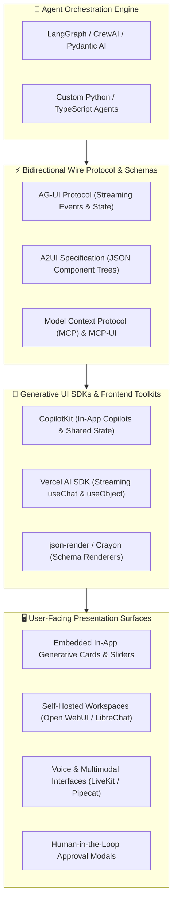

  

# 🤖 Awesome AI Agent UI &amp; Interaction Protocols 🌐

### *The Definitive Curated Directory of Agent-User Interaction Protocols (AG-UI, A2UI, MCP-UI), Streaming Generative UI SDKs, Human-in-the-Loop Approval Workflows &amp; Self-Hosted Agent Workspaces*

---

## 📖 Introduction &amp; Scope

Welcome to the **Awesome AI Agent UI &amp; Interaction Protocols** catalog! 🚀

As autonomous AI agents evolve from simple, single-turn text chat to complex multi-step reasoning systems executing real-world tasks, traditional chat interfaces (text-in, text-out) become insufficient. This repository tracks the rapidly expanding frontier of **Agent-User Interaction (AG-UI)**, **Agent-to-User Interface (A2UI)**, **Model Context Protocol UI (MCP-UI)**, **Generative UI (GenUI)**, and self-hosted AI agent workspaces.

### 🌟 Key Pillars Covered
- ⚡ **Agent-User Wire Protocols (AG-UI &amp; A2UI):** Standardized, event-driven streaming specifications enabling bidirectional communication, state synchronization, and execution events between agent backend runtimes (e.g., LangGraph, CrewAI, AutoGen, Pydantic AI) and frontend applications.
- 🎨 **Generative UI (GenUI):** Declarative, schema-driven, or streaming component rendering (React, Vue, Svelte, Lit, Flutter, Swift) that renders interactive cards, charts, forms, and tools directly instead of static markdown.
- 🔌 **MCP-UI Extensions:** Standards and sandboxed web views that bridge Anthropic's Model Context Protocol (MCP) servers with rich client-side UI components.
- 🛡️ **Human-in-the-Loop (HITL) Controls:** Specialized approval modals, live tool-call inspectors, interrupt handlers, and step rewinds to supervise autonomous decisions safely.
- 🖥️ **Self-Hosted Multi-Agent Workspaces:** Sovereign, open-source chat frontends and orchestration interfaces supporting multi-model routing, Artifacts, and custom tool extensions.

---

## 📑 Table of Contents
- [📊 Sector Overview &amp; Market Dynamics](#-sector-overview--market-dynamics)
- [☁️ SaaS / Hosted Platforms](#️-saas--hosted-platforms)
- [🐙 Open-Source GitHub Projects](#-open-source-github-projects)
- [🤝 How to Contribute](#-how-to-contribute)
- [💖 Support &amp; Sponsorship](#-support--sponsorship)
- [📈 Star History](#-star-history)
- [📄 Disclaimer](#-disclaimer)

---

## 📊 Sector Overview &amp; Market Dynamics

> 💡 **Market Size &amp; Growth:** The broader AI Agent and Agentic Workflow market is estimated at **$7.6B – $11.5B in 2024–2025** and projected to surge past **$110B – $290B+ by the early 2030s** (expanding at an aggressive **CAGR of ~43%–49%**), with the generative interface and front-of-glass interaction layer representing one of the fastest-growing enterprise subsegments.
>
> 🧩 **Market Fragmentation &amp; Concentration:** The sector exhibits a **concentrated foundational core** anchored by hyperscalers and dominant frontier platform providers (e.g., OpenAI, Anthropic, Microsoft, Snowflake, Vercel), while simultaneously fostering a **highly fragmented application, UI-component, and wire-protocol layer** where hundreds of agile open-source projects, startups, and developer frameworks compete to establish universal open standards (*AG-UI*, *A2UI*, *MCP-UI*, and *GenUI*).

---

## ☁️ SaaS / Hosted Platforms

Below is a curated comparison of leading SaaS and hosted platforms providing managed agent UIs, generative UI compilers, and interactive workspace platforms.

> **Sorted in descending order by company valuation / market size.**

| Platform | Description | Starting Price Tier | Free Tier Limits / Trial | Scale &amp; Valuation |
| :--- | :--- | :--- | :--- | :--- |
| **[OpenAI ChatKit / Agent Builder UI](https://openai.com)** | Managed platform visual workflow canvas and embeddable web chat components for deploying conversational assistants and tool-calling agents. | **$0** (Free design/canvas layer; usage billed at model token rates starting at $0.10/1M input tokens) | **1 GB free storage** per account/month for files and images; design &amp; canvas testing are free forever. | **Valuation: ~$157B – $300B** (ARR: ~$20B) |
| **[Vercel v0](https://v0.dev)** | Generative user interface cloud platform that synthesizes production-ready React, Tailwind CSS, and shadcn/ui components from natural language. | **$20/user/month** (Pro plan with $20 monthly usage credit included, v0 API access, and higher attachments) | **Free forever**: **$5/month** in usage credits renewing monthly on standard models (`v0-1.5-md`). | **Valuation: ~$9.3B** (ARR: ~$200M+) |
| **[Streamlit Community Cloud](https://streamlit.io)** | Managed cloud platform for deploying and sharing interactive Python data and AI agent web applications directly from GitHub. | **Custom / Enterprise** via Streamlit in Snowflake consumption pricing. | **Free forever**: Up to **1 private app**, unlimited public apps, 2 vCPUs, ~2.7 GB RAM (sleeps after 12h idle). | **Valuation: ~$800M** (Acquired by Snowflake for $800M) |
| **[Gradio Spaces / Hugging Face Spaces](https://huggingface.co)** | Cloud hosting platform for deploying and sharing interactive Gradio, Streamlit, and custom Docker AI agent interfaces with instant public URLs. | **$9/month** (Hugging Face PRO tier with 8× ZeroGPU priority, $2/mo compute credit, and Spaces Dev Mode) | **Free forever**: Basic CPU spaces (2 vCPU, 16 GB RAM), shared ZeroGPU (NVIDIA T4 pool), 100 GB private storage. | **Valuation: ~$4.5B** (ARR: ~$81M) |
| **[Dify Cloud](https://dify.ai)** | Hosted agentic workspace and visual orchestration canvas featuring embeddable web widgets, RAG pipelines, and multi-agent workflows. | **$59/workspace/month** (Professional plan including 5,000 message credits/mo, 50 apps, and 3 team seats) | **Free forever (Sandbox Plan)**: **200 message credits**, 5 apps, 50 knowledge documents (50 MB vector data), 1 seat. | **Valuation: ~$180M** (Series Pre-A raised $30M) |
| **[Botpress Cloud](https://botpress.com)** | Enterprise conversational AI and autonomous agent studio offering visual flow designers, customizable webchat widgets, and omnichannel bots. | **$150/month** (Plus plan, billed annually) or **$189/month** (billed monthly) | **Free forever**: **100 incoming conversations/month**, 3 bot agents, and up to 3 team collaborators. | **Valuation: ~$120M** (Total funding: ~$45M) |
| **[Stack AI](https://stack-ai.com)** | Enterprise AI workflow automation platform providing instant white-label chat interfaces, form-based agent portals, and internal assistant UIs. | **Custom / Enterprise** (Covers dedicated deployment and enterprise workflows; historical starter tiers from $199/mo) | **Free forever**: **500 workflow runs/month**, 2 projects, and 1 user seat. | **Valuation: ~$64M** (Series A raised $16M) |
| **[CopilotKit Cloud](https://copilotkit.ai)** | Managed cloud infrastructure and developer platform for embedding in-app AI co-pilots, AG-UI protocol endpoints, generative UI widgets, and shared agent state. | **$49/month** base org fee (Pay-as-you-go; includes 10,000 monthly interactions, then tiered volume rates) | **Free Developer Edition**: Free for local evaluation and non-production testing with a **renewable 30-day license**. | **Funding: ~$27M** (Series A + Seed backed by Glilot, NFX) |
| **[TypingMind](https://typingmind.com)** | Commercial web frontend for LLMs and AI agents offering custom agent personas, artifact previews, MCP tool integration, and team workspaces. | **$39** one-time lifetime license (Standard Plan; $79 Extended, $99 Premium with Artifacts &amp; MCP support) | **Free forever tier**: Basic web client mode with core chat preview (no saved history; requires BYO API keys). | **Revenue: ~$1M – $1.9M ARR** (Bootstrapped indie business) |

---

## 🐙 Open-Source GitHub Projects

Explore the most active and powerful open-source repositories for agent-to-user protocols, declarative generative UI schemas, streaming React/Python SDKs, and sovereign self-hosted agent interfaces.

> **Sorted in descending order by GitHub Stars_Count.**  
> *Click the social Stars_Badge to visit the stargazers page of any repository.*

| Project | GitHub_Stars | License | Description &amp; Focus Area |
| :--- | :---: | :---: | :--- |
| **[langgenius/dify](https://github.com/langgenius/dify)** |  | `Apache-2.0` | Production-ready open-source platform for visual agentic workflow orchestration, RAG pipelines, model routing, and embeddable conversational web UIs. |
| **[open-webui/open-webui](https://github.com/open-webui/open-webui)** |  | `BSD-3-Clause` | Feature-rich, self-hosted AI interface supporting Ollama, OpenAI-compatible APIs, web search, RAG pipelines, Python tool functions, and real-time voice/video interaction. |
| **[browser-use/browser-use](https://github.com/browser-use/browser-use)** |  | `MIT` | Open-source Python library for connecting AI agents directly to web browsers with real-time UI interaction, DOM perception, and visual click loops. |
| **[lobehub/lobe-chat](https://github.com/lobehub/lobe-chat)** |  | `MIT` | Modern open-source AI agent workspace and chat UI framework featuring MCP/plugin marketplaces, Artifacts, text-to-speech, visual recognition, and multi-model routing. |
| **[Mintplex-Labs/anything-llm](https://github.com/Mintplex-Labs/anything-llm)** |  | `MIT` | All-in-one local-first AI agent workspace with built-in RAG, multi-user permissions, embeddable chat widgets, and extensive desktop/web support. |
| **[danny-avila/LibreChat](https://github.com/danny-avila/LibreChat)** |  | `MIT` | Comprehensive open-source multi-provider AI chat platform featuring autonomous Agents, Code Interpreter, Artifacts, MCP server integration, and multi-user authentication. |
| **[streamlit/streamlit](https://github.com/streamlit/streamlit)** |  | `Apache-2.0` | Open-source Python framework for turning data scripts and AI agent workflows into interactive web dashboards and streaming chat apps in pure Python. |
| **[janhq/jan](https://github.com/janhq/jan)** |  | `AGPL-3.0` | Open-source, local-first alternative to ChatGPT running 100% offline with customizable agent assistants, local model engines, and clean desktop UI. |
| **[gradio-app/gradio](https://github.com/gradio-app/gradio)** |  | `Apache-2.0` | Popular open-source Python library for rapidly creating interactive web UIs, multimodal chat interfaces, and agent demos shareable via browser links. |
| **[CopilotKit/CopilotKit](https://github.com/CopilotKit/CopilotKit)** |  | `MIT` | Leading open-source React framework for building deeply integrated in-app AI co-pilots, generative UI components, and human-in-the-loop workflows backed by LangGraph, CrewAI, or Pydantic AI. |
| **[mckaywrigley/chatbot-ui](https://github.com/mckaywrigley/chatbot-ui)** |  | `MIT` | Clean, modern web chat interface built with Next.js and Tailwind CSS supporting multi-model switching, custom assistants, and prompt libraries. |
| **[vercel/ai](https://github.com/vercel/ai)** |  | `Apache-2.0` | Widely adopted open-source TypeScript toolkit providing unified streaming hooks (`useChat`, `useObject`), tool-calling UI state, and generative UI primitives across modern frameworks. |
| **[ag-ui-protocol/ag-ui](https://github.com/ag-ui-protocol/ag-ui)** |  | `MIT` | Open-source, lightweight event-based Agent-User Interaction protocol standardizing bidirectional streaming, shared state synchronization, generative UI, and human-in-the-loop events. |
| **[vercel-labs/json-render](https://github.com/vercel-labs/json-render)** |  | `Apache-2.0` | Open-source generative UI framework allowing AI agents to stream safe, schema-validated JSON UI trees rendered natively with React components. |
| **[google/A2UI](https://github.com/google/A2UI)** |  | `Apache-2.0` | Open-source declarative Agent-to-User Interface specification and renderer from Google enabling agents to safely stream structured JSON component trees across React, Angular, Flutter, and SwiftUI. |
| **[pipecat-ai/pipecat](https://github.com/pipecat-ai/pipecat)** |  | `BSD-2-Clause` | Open-source framework for voice agents, multimodal apps, and real-time WebRTC audio/video interaction pipelines with rich client frontends. |
| **[thesysdev/crayon](https://github.com/thesysdev/crayon)** |  | `Apache-2.0` | Open-source Generative UI SDK and open standard for dynamic, interactive agent interfaces rendering live cards, charts, and interactive widgets. |
| **[livekit/agents](https://github.com/livekit/agents)** |  | `Apache-2.0` | Developer framework for building real-time multimodal voice and vision AI agents over WebRTC with frontend UI stream synchronization. |
| **[assistant-ui/assistant-ui](https://github.com/assistant-ui/assistant-ui)** |  | `MIT` | TypeScript/React component library engineered specifically for AI chat and agent interfaces with streaming markdown, tool-call UIs, and thread branching. |
| **[Chainlit/chainlit](https://github.com/Chainlit/chainlit)** |  | `Apache-2.0` | Open-source Python framework for building production-ready conversational AI and multi-step agent interfaces with visual reasoning steps, custom elements, and Copilot widgets. |
| **[modelcontextprotocol/specification](https://github.com/modelcontextprotocol/specification)** |  | `MIT` | Official specification and wire standards for Anthropic's Model Context Protocol (MCP) connecting agents to tools, data, and interactive resources. |
| **[Nutlope/llamacoder](https://github.com/Nutlope/llamacoder)** |  | `MIT` | Open-source Claude Artifacts alternative for generating, rendering, and iterating on interactive web applications in real-time. |
| **[e2b-dev/fragments](https://github.com/e2b-dev/fragments)** |  | `Apache-2.0` | Open-source Next.js template and execution sandbox for building generative apps that are dynamically created and safely rendered by AI agents. |
| **[idosal/mcp-ui](https://github.com/idosal/mcp-ui)** |  | `Apache-2.0` | Protocol extension and SDK allowing Model Context Protocol (MCP) servers to return interactive, sandboxed web UI resources directly inside agent chat interfaces. |
| **[langchain-ai/agent-chat-ui](https://github.com/langchain-ai/agent-chat-ui)** |  | `MIT` | Official open-source Next.js interface from LangChain for interacting with LangGraph agents with live tool-call inspection and human-in-the-loop interrupts. |
| **[ibelick/prompt-kit](https://github.com/ibelick/prompt-kit)** |  | `MIT` | Accessible React &amp; Tailwind UI primitives for reasoning accordions, streaming tool badges, prompt inputs, and human approval prompts. |
| **[nluxai/nlux](https://github.com/nluxai/nlux)** |  | `MPL-2.0` | Lightweight, zero-dependency conversational AI JavaScript and React library for embedding customizable streaming chat UIs into any web app. |
| **[openresponses/openresponses](https://github.com/openresponses/openresponses)** |  | `Apache-2.0` | Open wire protocol standardizing agentic event loops, tool invocations, and interactive resource payloads between client runtimes and LLM servers. |

---

## 🛠️ Architectural Blueprint: Building Modern Agent Frontends

To build a modern, production-grade agent user experience, developers combine multiple layers of this ecosystem:

---

## 🤝 How to Contribute

Contributions are warmly welcomed! 🌟 Whether you are authoring a new open-source AG-UI wire protocol, creating a Generative UI rendering library, or launching a developer platform:

1. **Fork the repository** to your own GitHub profile.
2. **Create a branch** for your updates (`git checkout -b feat/add-awesome-project`).
3. **Add your entry** under the appropriate section:
   - For **SaaS platforms**, ensure starting price, free tier/trial limits, and company scale are clearly documented.
   - For **Open-source projects**, provide the repo link, license, and concise technical description.
4. **Submit a Pull Request** with a brief summary of why the tool is valuable for agent interface developers.

---

## 💖 Support &amp; Sponsorship

If you find this curated directory helpful for your development or research, please consider supporting the project:

- ⭐️ **Star the repository** to boost visibility and help other developers discover these protocols.
- 🍴 **Fork and contribute** your favorite agent frontends and specifications.
- 📢 **Share the project** on [X / Twitter](https://twitter.com), [LinkedIn](https://linkedin.com), and developer forums.
- ☕ **Buy me a coffee &amp; Sponsor the project**: Support continued open-source curation and research via the [GitHub Sponsor Dashboard](https://github.com/sponsors/ishandutta2007).

---

## 📈 Star History

---

## 📄 Disclaimer

*All product names, trademarks, logos, and brands mentioned in this repository are the property of their respective owners. Listing in this repository is strictly for educational, informational, and curation purposes and does not imply endorsement or official partnership.*
